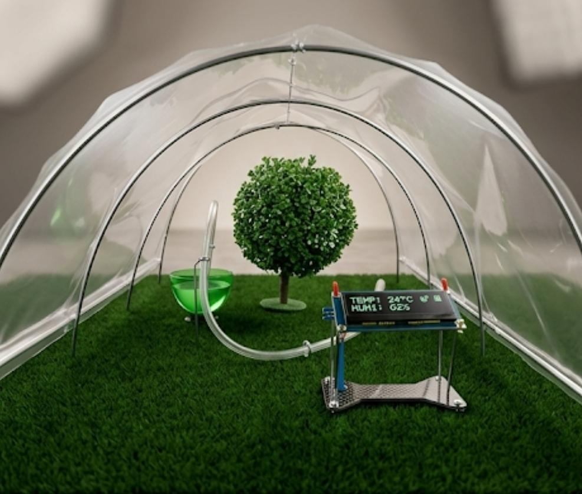
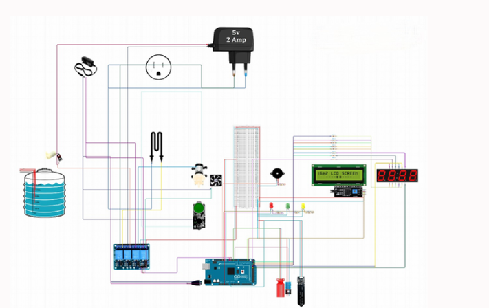
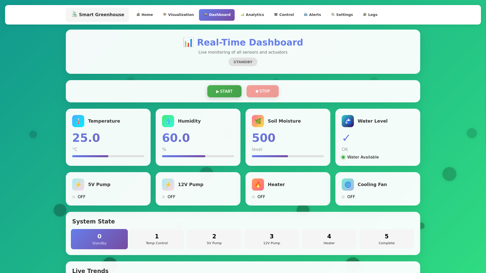

# 🌱 Smart Greenhouse

An automated greenhouse system built around an **Arduino Mega**. It monitors temperature, humidity, soil moisture and water level, controls pumps, a heater, a fan and lighting, and comes with a **web dashboard** featuring a built-in simulation mode.

> **Status:** v1.0, an academic project at ISIMM. See the (#-roadmap) for what's coming next.



---

## ✨ Features

-  **Environment monitoring:** temperature and humidity (DHT11), soil moisture, water tank level
-  **Automatic irrigation:** two water pumps driven by soil moisture and water level
-  **Climate control:** heater and fan to keep conditions in range
-  **Lighting:** LED control
-  **Local alerts:** buzzer and I2C LCD for on-site status and warnings
-  **Web dashboard:** 8-page single-page app with animated SVG visuals and a **simulation mode** (state machine) to test the system's behavior without hardware

---

## 🧱 Architecture (v1)

```
┌────────────────────┐      ┌──────────────┐      ┌────────────────────┐
│  Sensors           │      │              │      │      Actuators     │
│  DHT11, soil,      │─────▶│ Arduino Mega │─────▶│  pumps, heater,    │
│  water level       │      │  (control)   │      │  fan, LEDs, buzzer │
└────────────────────┘      └──────┬───────┘      └────────────────────┘
                                   │
                                   ▼
                            ┌──────────────┐
                            │   I2C LCD    │
                            └──────────────┘

        Web dashboard (HTML/CSS/JS) + MySQL backend on XAMPP
```

---

## 🔧 Hardware
|       Component      |                     Role                    |
|----------------------|---------------------------------------------|
| Arduino Mega         | Main controller (sensors, actuators, logic) |
| DHT11                | Temperature and humidity                    |
| Soil moisture sensor | Irrigation decisions                        |
| Water level sensor   | Tank monitoring                             |
| 2× water pumps       | Irrigation                                  |
| Heater               | Heating                                     |
| Fan                  | Ventilation / cooling                       |
| LEDs                 | Lighting                                    |
| Buzzer               | Alerts                                      |
| I2C LCD              | Local display                               |


Wiring diagram:



---

## 💻 Software Stack

- **Firmware:** Arduino C/C++ (Arduino Mega)
- **Dashboard:** HTML / CSS / JavaScript single-page app
- **Backend:** MySQL on XAMPP

---

## 📁 Project Structure

```
Smart-Greenhouse/
├── firmware/
│   └── arduino-mega/      # Sensor reading, control logic
├── dashboard/             # Web dashboard + backend
├── docs/                  # Photos, wiring diagram, screenshots
└── README.md
```

---

## 🚀 Getting Started

### 1. Hardware
Wire the components following `docs/wiring.png`.

### 2. Firmware
1. Install the [Arduino IDE](https://www.arduino.cc/en/software).
2. Install the required libraries: `DHT sensor library`, `LiquidCrystal_I2C`.
3. Upload `firmware/arduino-code/smartGreenhosueCodeV1.cpp` to the Arduino Mega.

### 3. Dashboard and database
1. Install [XAMPP](https://www.apachefriends.org/) and start **Apache** and **MySQL**.
2. Copy the `dashboard/` folder into `htdocs/`.
3. Create the database and import the SQL file: `dashboard/database.sql`
4. Copy `config.example.php` to `config.php` and set your database credentials.
5. Open `http://localhost/dashboard` in your browser.

> 🔒 `config.php` is listed in `.gitignore`. Never commit credentials.

---

## 📸 Screenshots



---

## 🧠 What I Learned

- **Handling noisy sensor readings:** [one sentence on how you solved it, e.g. averaging several samples or adding thresholds]
- **Structuring a dashboard around a state machine:** [one sentence on why it helped, e.g. clear states made simulation and testing simpler]

---

## 🗺️ Roadmap

- [ ] Connect the Arduino to an ESP32 via TX/RX and use its WiFi/BLE features
- [ ] Develop an Android dashboard app and connect it to the prototype
- [ ] Include a more reliable and renwable power source (solar panels)
- [ ] Improve documentation and add automated tests

---

## 🙏 Acknowledgments

Developed at **ISIMM** (Higher Institute of Informatics and Mathematics of Monastir) under the supervision of Dr. Rim Megdiche.

---

## 👤 Author

**Ahmed Akrout**

- GitHub: [@AhmedAkrout20](https://github.com/AhmedAkrout20)
- LinkedIn: [Ahmed Akrout](https://www.linkedin.com/in/ahmed-akrout-77aa9a376)

Feedback and suggestions are welcome. Feel free to open an issue.

---

## 📄 License

This project is licensed under the MIT License. See [LICENCE](LICENSE) for details.
